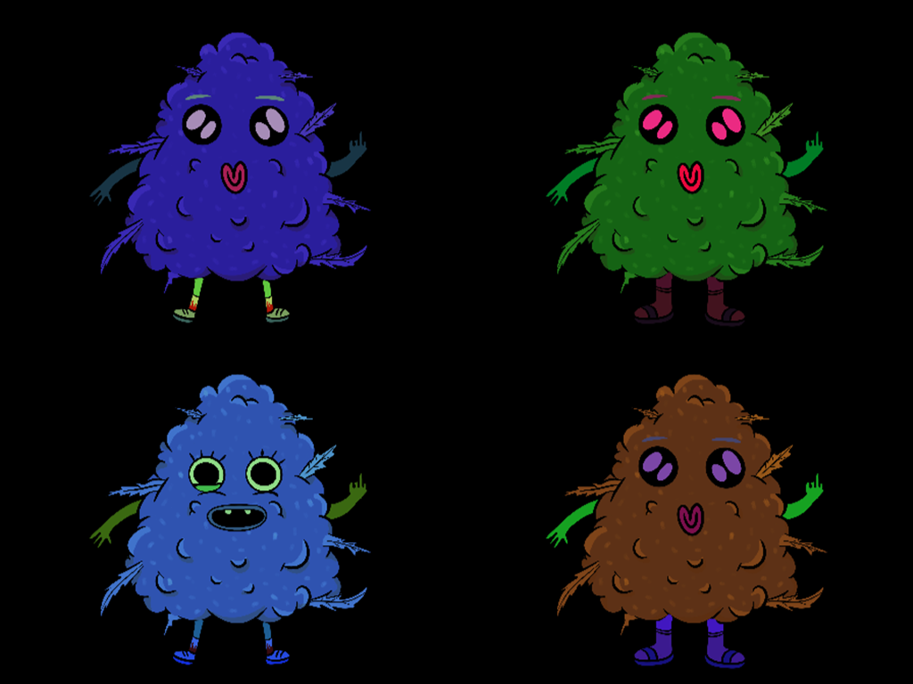

# nft

A 2D prototype (2022) on SFML and ImGui: a generator that layers random cogollo parts
(arms, body, face, feet) into a new character and tints each layer at random, and a
tiled map where two cogollos walk and drop bombs.

**Made without AI** until the first Claude commit (9ec6320, 2026-11-06); AI was used after that for the updated deployment and this README.

**Try it in your browser: https://kazin.dev/projects/nft/**



## Keys

| Scene | Keys |
|---|---|
| Gen (the generator, first) | `C` a new random cogollo |
| PacMan (the tiled map) | arrows + `B`: one cogollo walks and drops a bomb; `WASD` + Right Shift: the other; Ctrl + arrows: moves the map |
| every scene | Ctrl+S: the next scene (PacMan, Gen, an empty one, Dummy...); in a browser `N` (the browser keeps Ctrl+S for itself) |

Startup flag `scene=gen|pacman|dummy` opens that scene first (`client.exe scene=pacman`,
or `?scene=pacman` on the web page).

## Libraries

| Library | Version | Where |
|---------|---------|-------|
| kazilib | master (submodule) | `src/dep/kazilib`: `scene/manager.h` (the scenes), ImGui 1.84 and ImGui-SFML (`imgui/`, `sfml/imgui.h`; in a browser too), `stdnames.h`, `log.h` (`Out` / `Info` / `Warn` / `Err`), magic_enum, `dice.h` (`lib::Rand`), `initflags.h`, nlohmann json, the web port (`web/`) |
| SFML | 3.1.0 x86 | `src/dep/SFML-3.1.0`: a junction to kazilib's own `SFML-3.1.0` (made by `setup.ps1`) |

## Building

Visual Studio 2026 (v145 toolset). FASTBuild v1.20 is found next to the checkouts or
downloaded once.

```
git clone --recurse-submodules https://github.com/xkazinx/nft.git
powershell -ExecutionPolicy Bypass -File build.ps1
```

`build.ps1` runs `setup.ps1` (the kazilib submodule, the SFML junction), then kazilib's
FASTBuild runner (`src\dep\kazilib\fastbuild\`) on `src\fastbuild.json`: Release, x86,
with the 64-bit-hosted compiler and linker, distributed to the workers that answer
(MSBuild when FASTBuild is missing). Output: `build\client\client.exe` with the SFML
DLLs, next to the data it reads (`arial*.ttf`, `configs.json`, `default.txt`,
`data\cogollo\`). Run it from `build\client\`. `build.ps1 client` builds the client
alone; `-Configuration Debug` builds Debug (only when needed). Visual Studio builds the
same from `src\nft.sln`.

## In a web browser

Play at **https://kazin.dev/projects/nft/**: the same client compiled to WebAssembly
(Emscripten) with kazilib's SFML 3.1 web port (`src\dep\kazilib\web\`: SFML's window on
SDL3, its OpenGL ES 1 drawing emulated on WebGL2). The data is packed into `index.data`.

- The ImGui panel ("My First Tool") too: kazilib's `kazilib_web_imgui()` (imgui-SFML
  drawing through SFML in a browser); `src\client\CMakeLists.txt` takes it when kazilib
  has it (`NFT_WEB_IMGUI`), else the client runs without the panel.
- Scaled Window / Original Size / Fullscreen under the game (kazilib `web/shell.html`).

```
powershell -ExecutionPolicy Bypass -File build_web.ps1        # src\build\web\client-build\
powershell -ExecutionPolicy Bypass -File src\tests\web\run_web_test.ps1
```

`build_web.ps1` uses Emscripten from `D:\code\tools\emsdk` and the shared SFML web build
in `D:\code\tools\kazilib-web` (made by kazilib's `web\build_deps.ps1` when missing).
`run_web_test.ps1` opens the build in headless Edge (kazilib `web\tools\browser.js`),
makes four cogollos, switches scenes (`N`) and walks the tiled map, and saves screenshots in
`testerino\web\local\` (`-Url https://kazin.dev/projects/nft/` for the live page,
`testerino\web\live\`).

## The deployment

```
powershell -ExecutionPolicy Bypass -File deploy_ubuntu.ps1
```

Builds the web client and sends it with `deploy\ubuntu\` to the box `kazin-music`:
`/opt/nft/web` (swapped whole), served by Caddy (`/etc/caddy/sites/kazin.dev.d/nft.caddy`)
at `https://kazin.dev/projects/nft/`. Static files only: no service.

## Pictures

`docs\showcase\`: canvas shots of the live page (`1_generator` .. `3_generator`,
`4_tiled_map`, `5_four_cogollos`); `docs\showcase\kazin\nft.jpg`, `nft-1.jpg` ..
`nft-4.jpg`: the same as 1024x768 JPEGs for kazin.dev.

---

## Original README (2022-03-25, commit e355683)

The README as its author wrote it, kept word for word under the new one:

# rythme
